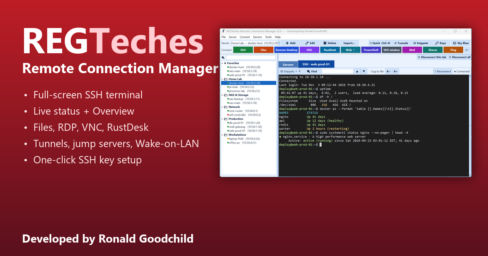
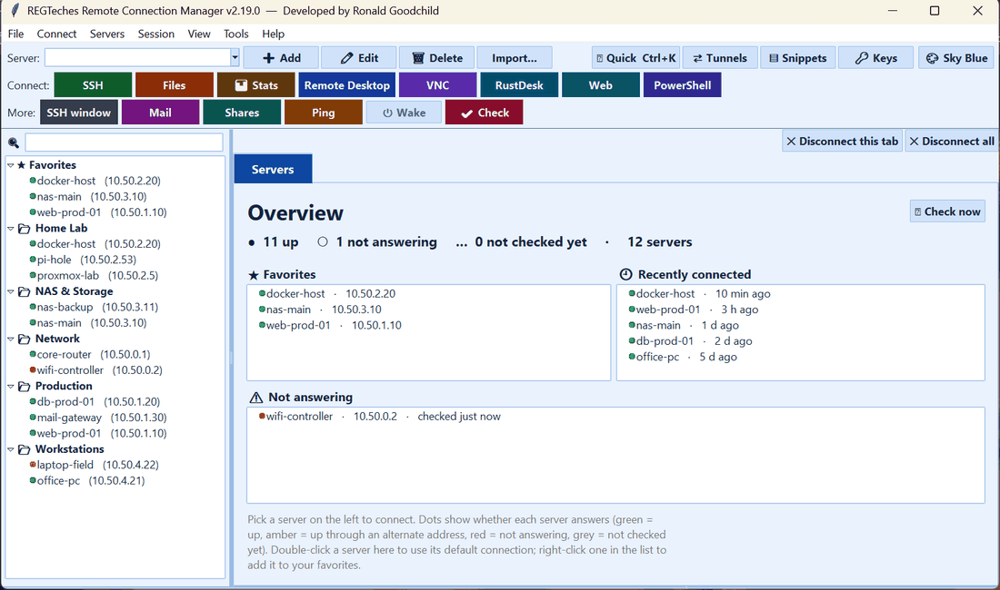
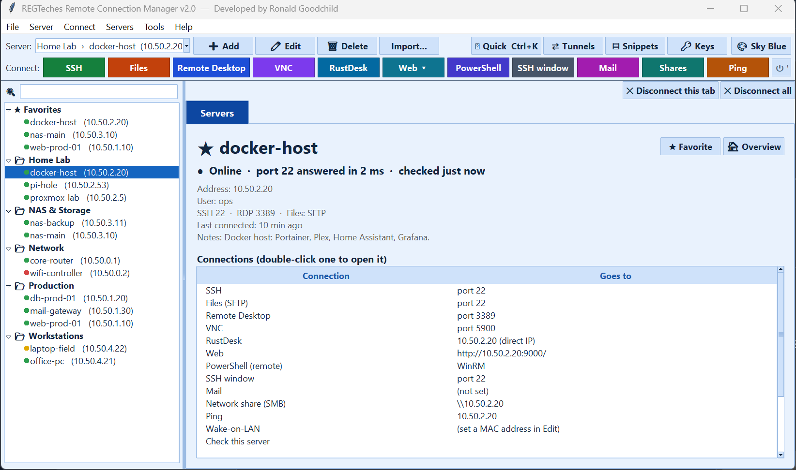
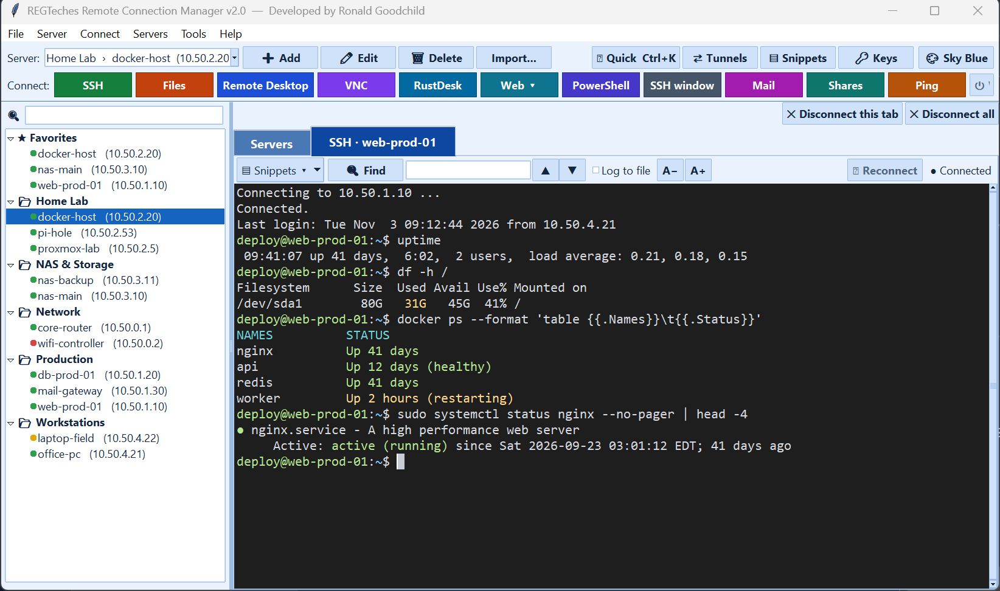
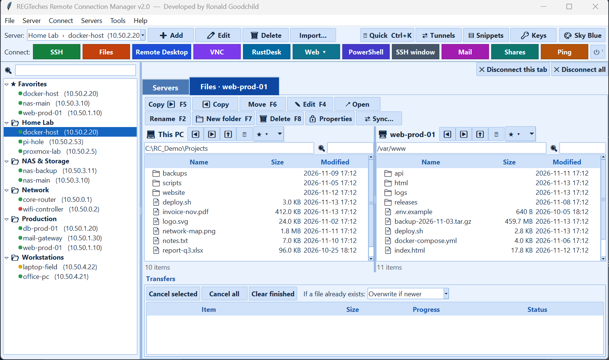
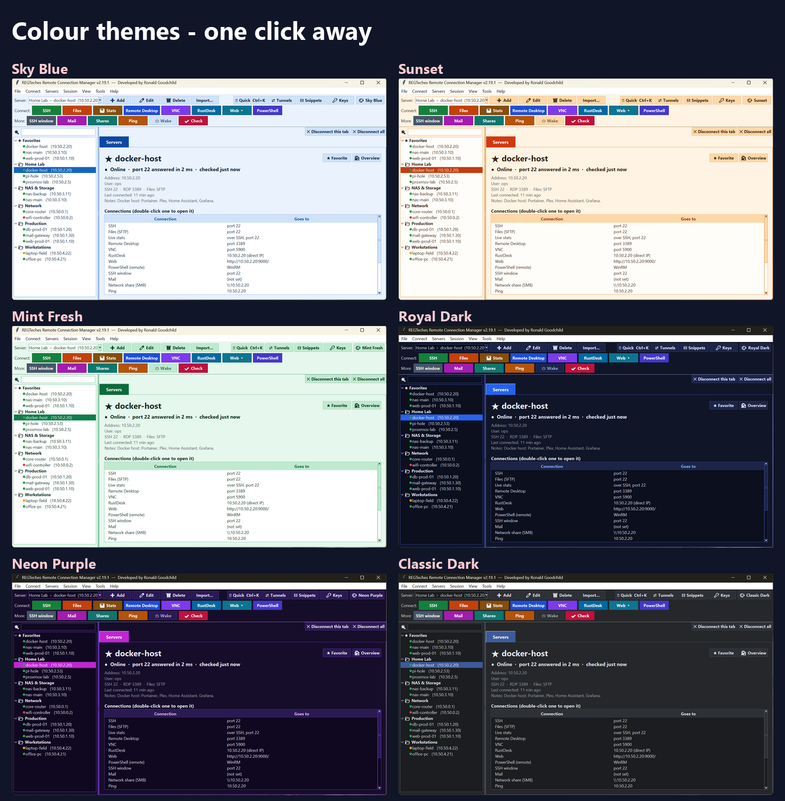

# REGTeches RC - Remote Connection Manager  v2.12.0

*Developed by Ronald Goodchild - REGTeches, Jacksonville FL*



**Free and open source (MIT).** SSH terminal, file manager, Remote Desktop, VNC, RustDesk, tunnels and live server status - all in one window.

[](screenshots/RC_tour.mp4)

**[▶ Watch the 1-minute video](screenshots/RC_tour.mp4)**

One window for every server you connect to (IP address or DNS name). Add and delete
servers by mouse, group them, search them, and click the way in you want.

**Help > Quick start guide** shows this whole guide as a formatted web page in your browser (contents list on the left).

**Install with Scoop:** `scoop bucket add regteches https://github.com/ronaldgoodchild/scoop-regteches` then `scoop install rc` (updates with `scoop update rc`; your servers are kept between updates).

**Start it:** double-click `RC.bat` (or `python rc_manager.py`). The program is `rc_manager.py` plus `rc_terminal.py` (the SSH terminal), `rc_files.py` (file manager), `rc_monitor.py` (live stats), `rc_identity.py` (identities and proxies), `rc_quick.py` (quick commands, history, login scripts), `rc_transport.py` (Telnet and Serial), `rc_backup.py` (backup), `rc_netscan.py` (network scan), `rc_localsrv.py` (TFTP/HTTP servers), `rc_import.py` (MobaXterm/Xshell import), `rc_record.py` (recording), `rc_notes.py` (notes), `rc_glances.py` (Glances), `rc_zmodem.py` (Zmodem), `rc_prefs.py` (preferences and remembered tabs), `rc_tools.py` (palette, tunnels, snippets, key setup, trusted keys) and `rc_theme.py` - keep the eighteen together. (Serial also needs `pyserial`, in `requirements.txt`.) First time only: `pip install -r requirements.txt` (paramiko for SSH, pyte for the terminal).

## What's new in 2.0

A real full-screen SSH terminal with auto-reconnect, live status dots and an Overview home screen, other addresses
and jump servers, Wake-on-LAN, a trusted-host-keys manager, VNC and RustDesk buttons, and this guide as a web page.
The full list is in `CHANGELOG.md`. Your servers and saved logins carry over unchanged.

## A look around

**The Overview** - live status dots, favorites and recently used servers.


**Every way in, one click** - SSH, Files, Remote Desktop, VNC, RustDesk, Web and more, per server.



**A real SSH terminal** - full-screen programs, colours, scrollback, auto-reconnect.



**Drag-and-drop file manager** - SFTP, FTP and FTPS.



**Seven colour themes** - pick one with the Colors button.



## What each button does

| Button | What happens |
|---|---|
| SSH (in app) | A real terminal tab inside the window: full-screen programs (vim, nano, htop, less, mc, tmux) work, 256/true colour, scrollback, font zoom, auto-reconnect - see *The SSH terminal* below |
| Files - SFTP/FTP (in app) | Two-pane file manager (this PC on the left, the server on the right) - see *File manager* below. Protocol per server: SFTP, FTP or FTPS |
| 📊 Stats | Live CPU, memory, network, disks, processes and listening ports of a Linux/NAS server, refreshed every few seconds over SSH - see *Live stats* below |
| Remote Desktop | Opens Windows `mstsc` with the address, port and username filled in |
| Web | Opens the server's web address in your default browser |
| PowerShell (remote) | New PowerShell window running `Enter-PSSession` to the server (WinRM, for Windows servers) |
| SSH (separate window) | Windows' own `ssh` in a console, if you prefer that to the in-app terminal |
| Mail | Opens the server's webmail address (set it in the server's settings) |
| Ping | Four pings, result in a popup (the time it took is logged) |
| ⏻ Wake | Sends a Wake-on-LAN packet to switch the machine on (needs its MAC address, see *Wake-on-LAN*) |
| ✔ Check this server | Looks the name up in DNS and tests each service: SSH and FTP must answer like SSH/FTP, Remote Desktop port open, web page responds |

**Pick a server** from the Server drop-down at the top (or the list on the left, or the **Servers** menu: group > server > how to connect), then click a Connect button along the top. Add/Edit open as a tab inside the window, not a popup.

Double-click a server to run its **default** action (set per server). Right-click for the full menu.
Close a session tab with right-click > Close tab, middle-click, or Ctrl+W.

## Colour themes

Seven themes: **Sky Blue** (default), **Sunset**, **Mint Fresh**, **Royal Dark**, **Neon Purple**, **Classic Dark** and
**Classic Light** (plain Windows look). Click the 🎨 button at the top right to cycle through them, or pick one under
View > Color theme. The choice is remembered in `settings.json`. Tabs, buttons and headings are bold with high-contrast
text. The SSH terminal keeps its own dark colours in every theme. The Windows menu bar along the very top can't be recoloured.

## Keys for the whole lab (Keys button)

Tools > Credentials > **Set up keys for all servers** (or the 🔑 Keys button) creates one ed25519 key for *this* PC - no passphrase, no
expiry - and installs it on every server you tick. Type each server's username/password once; RC installs the public key
(Linux, Synology, routers with Dropbear, Windows OpenSSH), tests a key-only login, and remembers the key for that server.
Servers that already accept the key are skipped. Using a second PC (for example over a VPN)? Run the Keys tab there too:
each PC gets its own key, and no private key is ever copied between machines.

## Disconnecting

**Disconnect this tab** / **Disconnect all** (also File menu, Ctrl+W, middle-click or right-click a tab). Tunnels keep
running until stopped on the Tunnels tab or RC is closed.

## Quick connect (Ctrl+K)

Press **Ctrl+K** (or the Quick connect button), type a few letters - `plex ssh`, `nas web`, `tunnel` - and press
Enter. It searches every server and every connection (including extras), your tunnels and snippets, and a few
commands. Up/Down to choose, Esc to close.

## File manager (Files button)

Modelled on WinSCP's Commander layout: this PC on the left, the server on the right.

- **Drag and drop** files and folders between the panes (drop on a folder row to go inside it), or use the buttons /
  keys: **F5** copy, **F6** move, **F7** new folder, **F8** delete, **F2** rename, **F4** edit. Several items at once work.
- **Transfer queue** at the bottom: progress bars, cancel one or all, and a separate connection so you can keep
  browsing while big copies run. *If a file already exists:* overwrite if newer (default), overwrite, skip, or ask.
  Copies keep the original timestamps, so a second copy of an unchanged file is skipped.
- **Synchronize...** (button): compares this PC's folder with the server's folder - update the server, update this
  PC, or both ways (newer wins); *Synchronize* copies new/newer files, *Mirror* makes the target match. **Preview
  changes** shows a checklist first; untick anything you don't want, then **Apply**. Deleting target-only files is
  off by default and asks before it runs.
- **Edit (F4)**: built-in text editor (Ctrl+S saves straight back to the server, keeps Windows line endings).
  **Open** hands the file to the Windows program for its type and uploads it again every time you save there.
- **Right-click menu** on any item (or empty space): Edit / Open, Copy or Move to the other side (F5 / F6), **Copy, Cut and
  Paste here** (Ctrl+C / X / V), Rename, **New folder, New file**, Delete, Properties, **Copy path**, **Type path into the SSH
  terminal**, Select all (Ctrl+A), show/hide hidden files, Refresh.
- **Copy / Cut / Paste:** on the same side it happens in place. On the server a copy runs `cp -a` *on the server* (nothing travels
  through this PC; needs SFTP and a Unix-like server) and a cut is a rename; a name that already exists gets "(copy)" /
  "(copy 2)", and a cut never overwrites. Copy on one side and paste on the other and it is queued as an upload or download
  (a cut then moves it).
- **Clickable path trail** above each list (click any folder in the path to go there), **click a column heading to sort**
  (arrow shows the direction; folders stay on top) and **Show hidden files** in the right-click menu.
- **Type path into the SSH terminal** types the selected path(s), shell-quoted, with no Enter, into this server's open SSH
  terminal tab. **Copy path** puts them on the clipboard.
- **Queue:** **⏸ Pause** holds the waiting transfers (the current one finishes) and **▶ Resume** continues; **↻ Retry failed**
  puts every failed transfer back in the queue.
- **Properties** shows size/date and lets you change permissions (octal, like 755). Recursive delete, filter box
  per pane, back/forward/up, **★ bookmarks** per server (and quick folders on this PC), and RC reopens the last folder you were in.

## Key login setup

On a server's Edit tab, **🔐 Set up key login**: RC makes an SSH key (or uses the one you chose), installs it on the
server, proves it works with the key alone, and offers to forget the saved password. Works for Linux/Unix/NAS and
for Windows OpenSSH (including administrator accounts). Keys live in `~/.ssh` (`rc_<server>` by default).

## SSH tunnels (Tools > Network > SSH tunnels, or the Tunnels button)

Local (a port on this PC reaches a service behind the server), Remote (a port on the server reaches something here)
and Dynamic (a SOCKS5 proxy). Start/stop with one click, status per tunnel, **Open in browser** for local ones.
They use the server's saved login or key and stop when you close RC. Example: Local, listen 8081, destination
`10.0.0.20:5000` through your Linux box, then open `http://127.0.0.1:8081`.

## Snippets (Tools > Snippets, or the Snippets button)

Saved commands. **Run on any servers you pick** (or a whole group): RC connects to each with its saved login/key
and shows the result per server. In an SSH terminal tab the **Snippets** menu types one into the session. The SSH
terminal also has **Find** (search the output) and **Log to file** (saved in the `logs` folder, no colour codes).

## Import

**File > Import servers > From PuTTY / WinSCP / ssh config** lists the servers those programs know and lets you add them.
(Their stored passwords are encrypted for them and can't be read - enter a password once or use a key.)
**File > Import servers > From a CSV / text file** handles a plain list.

## Recording and playing back a session

Tick **⏺ Record** on any terminal tab (SSH, Telnet or Serial) to save what the server sends, with its timing, as a
`.cast` file in the `recordings` folder (the standard asciicast v2 format, so it also plays in asciinema tools). Untick it
or close the tab to finish the file. **Tools > Play a terminal recording…** opens a player tab: ▶ Play / ⏸ Pause,
⟲ Restart, a speed box (0.5x to 8x), **Skip long pauses** (waits are cut to 2 seconds), and a slider to jump anywhere (the
screen is rebuilt as it was at that moment). It uses the same screen as a live session, so colours and full-screen programs look
right, and it follows the recorded window size. Only the server's output is recorded, not your keystrokes, but a recording
shows everything that was on the screen, so treat it like a log: it may contain secrets. `recordings` is in `.gitignore`.

## Notes (Tools > Notes, or right-click a server > Notes…)

Free-form notes with **tags**, optionally attached to a **server**: rack positions, which switch port goes where,
"how I fixed it last time". Search words match the title, text and tags; filter by tag or by server. Write in Markdown
(lines starting with # for headings and - for bullets, double asterisks for bold, single asterisks for italic, backticks for code, and fenced code blocks) and tick **Preview** to see it
formatted. Notes save as you type (`notes.json`) and are included in **File > Backup**, where they stay attached to the right
server on the new PC. Right-clicking a server > Notes… shows that server's notes, or starts a new one for it.

## Importing from MobaXterm and Xshell (File > Import servers)

- **MobaXterm:** in MobaXterm use *Sessions > Export* to get a `.mxtsessions` file, then **From MobaXterm…** in RC.
  SSH, SFTP, Telnet, RDP, VNC, FTP and Serial sessions come across; MobaXterm's folders become RC groups.
- **Xshell:** **From Xshell (Sessions folder)…** and pick the folder that holds your `.xsh` files (usually
  `Documents/NetSarang Computer/<version>/Xshell/Sessions`; RC starts there). SSH, SFTP, Telnet and FTP sessions come
  across; sub-folders become groups.
- Both open the same selection list as the PuTTY/WinSCP import: servers already in RC are marked and not selected.
  Passwords are never imported (those programs encrypt them for themselves), so enter a password once or use a key. Telnet
  and Serial sessions become that kind of connection under *More connections*.

## Backup and restore (File > Backup)

Saved passwords in `hosts.json` are encrypted for *one* Windows account on *one* PC, so copying the file to another PC
loses them. **File > Backup > Back up everything (encrypted)…** asks for a password of your choice and writes one
`.rcbackup` file holding your servers (with extra connections, tunnels, bookmarks and their saved passwords),
snippets, workspaces, identities, proxies, notes and trusted host keys. The file is locked with that password (scrypt +
AES-256-GCM); without it nothing in the file is readable, and the password cannot be recovered. **Restore from a
backup…** works on any PC: RC re-encrypts the passwords for that PC and account. It then asks whether to **add what is
missing and overwrite servers that match** (same id, or same name and address) or to **only add what is missing**.
References (workspaces, jump servers) follow matched servers. A safety copy of the server list as it was is saved first
(`hosts.json.before-restore-<time>`). Not in the backup: the SSH key *files* themselves (copy `~/.ssh` yourself; RC tells
you how many servers use one), command history and settings.

## Network scan (Tools > Network > Network scan)

Type a network (`192.168.1.0/24`, filled in for this PC's own /24) or a range (`192.168.1.10-50`) and the ports
(`common`, `22,80,443` or `1-1024`) and click **Scan**. Every address is tried with plain TCP connects (a "refused"
answer also proves a machine is there); each machine found is listed with its name (reverse DNS), MAC address (from
this PC's ARP table), open ports with service names, and **✔ name** if it is already a server in RC. **Add as server…**
(or double-click) opens the Add form prefilled (name, address, MAC, and a sensible double-click action: SSH, Remote
Desktop, VNC or the web page). **Scan more ports on this machine…** deep-scans one machine; **Copy** and **Export CSV…**
save the list; click a heading to sort. At most 1024 addresses per scan. Scan only networks you are allowed to scan.

## Local servers: TFTP and HTTP (Tools > Network > Local servers)

Temporary servers on this PC for devices that fetch files, such as a switch loading a config or firmware by TFTP. Pick a
folder and a port, click **Start**, and the tab shows the addresses other devices should use and logs every request.

- **TFTP** (port 69): read-only unless **Allow uploads** is ticked (new files only, unless **allow overwriting** is
  ticked as well). Supports the block-size and size options. Binary transfers only.
- **HTTP** (read-only, a free port is suggested): optional folder listings; uploads and deletes are refused.
- Both refuse anything outside the chosen folder, can **stop by themselves after N minutes** (default 30), and stop when
  RC closes. While a server runs, anyone on your network can read the folder: serve only what you mean to share.
- Windows reserves some port ranges for Hyper-V / WSL / Docker (for example 7980-8179 here); RC picks a usable default
  and explains it if a port you type cannot be used. Windows may ask to allow the program through its firewall.

## Telnet and Serial (COM port) terminals

For switches, routers, UPSes and other gear that has no SSH. Add the connection on a server's Edit tab under
**More connections** (type **Telnet** or **Serial (COM port)**), and a **Telnet** or **Serial** button appears for that
server (and in the Connect menu, Quick connect and the Servers menu). They open the same terminal tab as SSH, so
Find, logging, scrollback, colours, Broadcast, the Quick panel and after-login scripts all work.

- **Telnet:** the port defaults to 23. RC answers the usual option negotiation itself (terminal type, window size,
  server echo) and follows window resizes. It goes through the server's proxy if it has one. The server hanging up
  counts as a log-out (no automatic retry). Telnet sends everything, passwords included, unencrypted: use it only on
  trusted networks. For the login, use *After login*: `login: => ${user}` then `assword: => ${password}` (the user and
  password come from the server's saved login or identity).
- **Serial:** put the settings in the **Address / COM port** box: `COM3` or `COM3, 115200, 8N1, rtscts` (speed, then
  data bits / parity / stop bits, then `rtscts` or `xonxoff` for flow control). A speed typed in the Port box is used
  when the text has none; the default is 9600 8N1. **Tools > Network > Serial ports on this PC…** lists what is plugged
  in. A port that is missing or busy says so and waits for you to click Reconnect instead of retrying; an unplugged
  cable counts as a lost connection. Needs the `pyserial` package (included in RC.exe). A device reached only by
  cable still needs an address in the server entry: type `localhost`.

## Terminal colours, font and clipboard

Right-click a terminal (or **View** menu) for **Colours** (Dark, Light, Solarized Dark, Dracula, Monokai, Nord, Gruvbox
Dark, Green on black; applied to every open terminal, including what is already on screen, and remembered), **Font…**
(fixed-width fonts only, with a sample), **Copy when I select text**, **Right-click pastes (no menu)** and
**Middle-click pastes** (on by default), and **Save output to a file…** (the whole scrollback plus the screen as plain text).
Settings are in `terminal.json`.

## Quick commands, history and login scripts

- **⚡ Quick** (button on every SSH terminal) opens a side panel with two tabs.
  - **Commands** are your snippets (Tools > Snippets), now with an optional **Group** so they are listed under headings
    (the terminal's Snippets menu groups them too). Search at the top. **Double-click or Paste** types the command
    *without* pressing Enter so you can check or edit it; **▶ Run** types it and presses Enter (asking first if the
    snippet says so); **Copy** puts it on the clipboard.
  - **History** lists the commands you typed, newest first with a count, with a search box. Run, Paste, Copy, **Save as
    command…** (turns one into a quick command), Delete and Clear all. History is stored on this PC only (`history.json`)
    and **Remember what I type in terminals** switches it off.
- **What history never records:** anything typed at a Password / passphrase / code / PIN prompt, anything typed inside
  vim, less, top and other full-screen programs, lines you edited with the arrow keys, Tab or Ctrl keys (RC can't know
  what the shell finally ran), and lines starting with a space (type a space first to keep a command out of the history).
  Broadcast copies and the terminal's own replies are never history.
- **Multi-line paste check:** pasting (or a quick command / history entry that has several lines) first asks
  "Paste N lines?" showing the first lines, because Enter inside the text runs each line, and with Broadcast on it runs
  on every ticked terminal. One line pastes straight in.
- **After login (per server):** on a server's Edit tab, *After login, type* takes one step per line:
  `wait-for-text => what to type`. After every connect RC watches the server's output and, when the text (a pattern, case
  doesn't matter) appears, types the reply and presses Enter. Example for a box where you always want root:
  `$ => sudo -i` (a lone `$` means the `$` prompt; in longer patterns write `\$`) then `assword => ${password}` then `# => cd /var/log`. An empty wait (`=> echo hi`) types after a short
  pause; `${user}`, `${host}` and `${password}` are filled in (the password is never written to `rc.log`); `//` starts a
  note. A step that doesn't show up within 10 seconds stops the script and says so in the terminal; a script that can't be
  parsed is reported on the Edit tab's Verify/Save and not run. It runs again after an automatic reconnect.

## Identities and proxies

**Identities (Tools > Credentials > Identities):** a reusable login. Create one (a name, a username, and a password, a
key file, or "SSH agent / default keys"), then pick it on a server's Edit tab under **Saved login (identity)**. That
server then connects with the identity's username and password or key, *instead of* its own, so changing a password
once changes it for every server that uses it. Passwords are encrypted for your Windows account, as before. A server
keeps its own Username/Password fields (they apply again if you set the identity back to "(none)"). An extra connection
that has its own login (Edit > More connections) keeps it. Deleting an identity sends its servers back to their own
settings. (The Edit tab's *Test login* and *Set up key login* buttons use the server's own fields, not the identity.)

**Proxies (Tools > Network > Proxies):** a **SOCKS5** or **HTTP (CONNECT)** proxy, with an optional username and
password. Pick it on a server's Edit tab under **Connect via proxy**. SSH terminals, file transfers over SFTP, tunnels,
Stats, snippets and key setup then go through it, and the server's status dot is tested through it too. FTP/FTPS, Remote
Desktop, VNC, web and ping do not use proxies. With SOCKS5 the proxy looks the server's name up itself, so names that
only resolve on the far side work. The **✔ Test…** button connects to a host:port through the proxy and shows what came
back or exactly why it failed. A server that also has a jump server uses the jump server's own proxy setting for the
first hop. Files: `identities.json` and `proxies.json` next to `hosts.json` (never publish them).

## Tabs, shortcuts and Preferences

- **Tab right-click menu:** Duplicate this session, Rename, **🔒 Lock tab** (a locked tab will not close by Close, middle-click,
  Disconnect all or Close other tabs, until you unlock it), and **Close several tabs** (others / to the right / to the left; locked
  tabs and the Servers tab stay). **Drag a tab** to change the order (the Servers tab stays first). The Session menu has the same
  lock and close-others items.
- **Shortcuts** (they work while you type in a terminal too, and are not sent to the server): **Ctrl+1 … Ctrl+9** go to that tab
  (Ctrl+9 = the last), **Ctrl+Tab / Ctrl+Shift+Tab** next / previous tab, **Ctrl+Shift+D** duplicate the terminal session. The full list
  is in Tools > Preferences.
- **Tools > Preferences** (saved in `prefs.json`, applied at once): ask before closing RC while sessions are open or files are being
  transferred (on by default); **reopen my SSH / Files / Stats tabs from last time** when RC starts (off by default; servers without a
  saved login ask for it again); how often the server list checks whether each server is up (off, 30 s, 1 / 5 / 15 min); the refresh
  interval for new Stats tabs; and **interface size** (80% to 200%).
- A server that is reachable only through a **proxy** now gets the right status dot (the background check was ignoring the proxy).

## Zmodem: rz and sz in the SSH terminal

Servers that have `rz` / `sz` (the `lrzsz` package; `apt install lrzsz`) can move files through the terminal itself, no file
manager needed.

- **Download:** run `sz somefile` (or several files) on the server. RC sees Zmodem start, asks **once** for a folder to save
  into (remembered; change it from the right-click menu > *Folder for files received with Zmodem…*), and saves the files there.
  A file that already exists is never overwritten: the new one is saved as `name (copy).ext`.
- **Upload:** run `rz` on the server, or right-click the terminal > **Upload files with Zmodem (runs rz -be)…**. RC asks which
  files to send.
- Progress shows in the status bar, with a **✕ Cancel Zmodem** button on the terminal's toolbar while it runs. The terminal
  carries on normally afterwards, and a line in the terminal says what was sent or received.
- Safety: the file names a server announces are reduced to the plain file name (a server cannot write outside the folder
  you chose), and commands a server asks the client to run are refused. Damaged blocks are re-sent automatically; the
  protocol is written in Python (`rc_zmodem.py`) and tested against the real `sz` and `rz` programs.
- Works in **SSH** terminals only. **Zmodem file transfers (rz / sz)** in the right-click menu switches the detection off.

Also in the right-click menu: **Clear screen (keep scrollback)** clears the visible screen but scrolls what was on it into the
scrollback instead of erasing it.

## Stats from Glances (Edit > Glances)

If a machine already runs [Glances](https://nicolargo.github.io/glances) (`glances -w`, web mode, default port 61208), tick
**Use Glances for this server's Stats** on the server's **Glances** tab, or just click **🔎 Detect / test Glances**: RC looks
for it on that address and port and ticks the box itself when it answers. It stays unticked for machines without Glances, and
Stats then uses SSH as before. With it ticked the Stats tab reads Glances' REST API (one read-only request per refresh; API
v4, falling back to v3), so it works for **PCs and servers you have no SSH login for, including Windows PCs**. You get the
same tiles, graphs, processes, disks and network, plus a **Containers** tab (Docker / Podman) and the hottest temperature sensor,
and the System tab lists the sensors. What needs SSH is not available in this mode: sending signals to processes (double-click a
process shows its details instead), the Services list and the Listening ports list.

Set the **port** if Glances uses another one, the **username and password** if it was started with `--password` (the user
defaults to `glances`; the password is stored encrypted like the other saved passwords), and **https** if it was started with
`--enable-https` (self-signed certificates are accepted). The Network scan also lists port 61208 as "Glances", and **Add as
server** from a machine showing it ticks Glances for you.

## Live stats (📊 Stats button)

Click **Stats** (or **Connect > Live stats**) to watch a server: it logs in over SSH with the saved login or key and
refreshes every 2, 5 (default), 10, 30 or 60 seconds. Nothing is installed or changed on the server: one read-only
script reads `/proc`, `df`, `ps` and `ss`.

- **Tiles:** CPU % with a graph (cores and load average underneath), memory and swap, network download/upload with a
  graph, and the server's name, system and uptime.
- **Processes:** sortable by clicking a column heading, with a filter box; busy ones are tinted amber (40%+ CPU) or
  red (80%+). **Disks** are tinted at 80% and 90% full. **Network** shows each interface's speed and totals.
  **Listening ports** lists what the server is serving (program names appear when the login is root).
- **Process details and signals:** double-click a process (or click **Details / send signal…**) to see its full command
  line, program, working folder, memory, open files and disk I/O. Pick TERM (stop politely), HUP (reload), INT or KILL
  and click **Send…**; RC always asks first (KILL gets an extra warning). For another user's process the login must be
  root or have passwordless sudo (RC retries once with `sudo -n`).
- **Services** (systemd servers): every service with its state and whether it starts at boot, a filter and a
  Running / Failed / Enabled switch (failed ones are red). Select one and **Start, Stop, Restart, Enable at boot,
  Disable at boot** (confirmation first, with an extra warning for ssh/network services that may carry your own
  connection) or **Logs…** for its last 200 journal lines. Needs root or passwordless sudo for changes.
- **System:** name, OS, kernel, CPU model, time zone, **clock difference from this PC** (flagged over a minute, a sign
  of broken NTP), every network interface with state, MAC, speed and addresses, and the disks/partitions (SSD or HDD).
  Services and System load when you click their tab; **⟳ Refresh** reads them again.
- **Pause**, **⟳ Now** and the interval are at the top. If the link drops, the tab reconnects on its own.
- Works on Linux, Raspberry Pi, Synology/QNAP and other Unix-like servers that have `/proc`. A Windows SSH server
  answers "not supported" (use Remote Desktop or the PowerShell button there). Very small busybox systems may show
  an empty process list if their `ps` lacks the `-o` option.

## Split view and Broadcast (Session menu)

- **Split view:** **Session > New split view** opens one tab that tiles up to 9 SSH terminals (Grid, Side by side or
  Stacked, from the *Layout* button). **➕ Add server** puts a server's terminal in a pane; **Session > Open selected
  server in a split view** does the same from the list. Double-click a pane's title (or click ⛶) to zoom it, ✕ closes
  it. Every pane is a normal terminal tab, with its own reconnect, Find, logging and scrollback.
- **Broadcast:** tick **📡 Broadcast** on any terminals (or **📡 Type in ALL panes** in a split view, or
  **Session > Broadcast: type in ALL open terminals**) and whatever you type or paste in one goes to all the ticked
  terminals, split panes and ordinary tabs alike. Ticked tabs show 📡. RC asks once before the first use. Be careful:
  Enter is sent too. Only what *you* type is copied; the terminals' own replies to their servers never are.
- **Workspaces:** once a split view is the way you like it, **💾 Save workspace** (or **Session > Save this split view
  as a workspace…**) stores its servers and layout under a name. **Session > Open workspace** lists them and opens one
  as a new split view in a click (a server whose login isn't saved asks for it as usual). **Manage workspaces…**
  renames or deletes them. Servers deleted since are skipped. Saved in `workspaces.json` next to `hosts.json`.
- **Session** also has *Duplicate this session* and *Rename this tab* (both also on a tab's right-click menu).
- **File** now holds all server-list actions (add, edit, duplicate, delete, favorite, import, **Export servers to a CSV
  file** - names, addresses, groups and users only, never passwords). **View** has Overview, colour theme and terminal
  text size. **Tools** groups Network and Credentials. **Help > Keyboard shortcuts** lists the keys.

## Several connections per server

Every server gets all the connection types (SSH, Files, Remote Desktop, Web, PowerShell, SSH window, Mail,
Network share, Ping, Check) with no setup. A server can also have **extras**: a second or third web page
(Sonarr, Radarr, NAS admin pages...), FTP *and* SFTP, an SSH on another port, a share path, a different
username. Add them in the server's Edit tab under *More connections*. The home tab lists everything a server
has (extras in blue; double-click to open). A button with a ▾ (like **Web ▾**) means that server has several:
click it and pick one. The **Servers** menu lists all of them too.

Network share opens `\\address` (or `\\address\share`) in File Explorer.
FTPS accepts self-signed certificates (usual on home servers) and supports port 990.

## Servers

- **➕ Add / ✏ Edit / 🗑 Delete** - all fields have sensible defaults; only the address is required. The form is split into
  tabs so it fits a small screen, with **Save / Verify / Test login / Set up key login / Cancel** always at the top:
  **General** (name, address, group, double-click action, notes), **Login** (username, password, identity, key file),
  **Connections** (ports, RustDesk, file transfer, web and mail addresses), **Network** (other addresses, jump server,
  proxy, MAC for Wake-on-LAN), **More connections** and **After login**. The Connect buttons are on two lines
  (**Connect** and **More**) for the same reason.
- **✔ Verify** (in the Add/Edit window) checks what you typed before you save: valid IP or DNS name (catches things like `192.168.1.300` or `host:22`), ports in range, the SSH key file exists and is a private key (not the `.pub`), web/mail addresses make sense, duplicates. Mistakes block Save; then it tests the server itself - name resolves, SSH/FTP ports really answer as SSH/FTP, Remote Desktop and web respond. Nothing is sent but a connection test; no login is attempted.
- **Import…** - CSV or text file, one server per line: `name,address,group,user` (or just an address). Bad addresses and duplicates are skipped and listed.
- Stored in `hosts.json` next to the program. Back that file up to keep your list.

## Saved logins

Fill in **Username** and **Password** on a server's Edit tab and click Save: from then on every connection uses
them with no prompt. A server's extra connections can have their own username and password. If you'd rather not
save anything, leave Password empty and RC asks when you connect (with a *Remember* box).

- **Where it's kept:** `hosts.json`, encrypted with Windows' own protection (DPAPI) tied to *your Windows account on
  this PC*, plus an app-specific key. The file is useless on another PC or user, and a password never appears in it as text.
- **On screen:** the Password box shows dots (tick *Show* to see what you typed). A saved password is never shown
  again; leave the box empty to keep it, type a new one to replace it, or tick *forget*. **Tools > Credentials > Forget ALL
  saved passwords** wipes every one.
- **🔑 Test login** (Edit tab) really logs in with what you typed and tells you if it worked, before you rely on it.
- **How it's passed along:** SSH, SFTP/FTP/FTPS in the app: used directly. SSH window: handed to `ssh` through its
  askpass hook (an environment variable, never the command line). PowerShell: via the new window's environment,
  turned into a credential, then erased. Remote Desktop and Network share: put in Windows Credential Manager for
  this sign-in only (Remote Desktop's entry is deleted after 2 minutes; Windows drops both at sign-out).
- **Keys are better where they work** (SSH key file on the server, or ssh-agent): then nothing needs saving. For a
  key with a passphrase, put the passphrase in the Password box.
- Anyone who can sign in to *your* Windows account (or run programs as you) can use your saved logins, as with any
  saved-password feature. Lock your PC.

## Other security notes

- The first time you reach an SSH/SFTP server you're shown its key fingerprint and asked to trust it.
  Trusted keys go in `known_hosts`. If a key later **changes**, the connection is refused with a warning.
- Plain FTP sends the password unencrypted - use SFTP or FTPS wherever the server offers it.
- `hosts.json`, `known_hosts`, `snippets.json`, `rc.log` and `logs` are in `.gitignore`; don't publish them.
- FTPS ignores certificate errors (home servers use self-signed certificates). Prefer SFTP where you can.
- Tunnels listen on 127.0.0.1 (this PC only) unless you deliberately type 0.0.0.0; RC asks before allowing that.

## The Overview and live status

With no server selected, the main tab is an **Overview**: how many servers are up or not answering, your **★ Favorites**,
the servers you **recently connected** to (and how long ago), and a **⚠ Not answering** list. Double-click any of them to
use its default connection; right-click for the full menu.

- **Status dots** beside every server in the list: green = up, amber = up through one of its *other addresses*, red = not
  answering, grey = not checked yet. RC checks every server in the background when it starts and then every minute
  (it tries the SSH port, then the Remote Desktop port - a refused connection still proves the machine is on - then a
  ping), and re-checks right away after you click **⟳ Check now** or send a wake packet. Changes (server went down /
  came back) are written to `rc.log`.
- **★ Favorites:** right-click a server > *Add to favorites* (or the ☆ button on its page). Favorites also get their own
  group at the top of the list.
- **Recent:** RC remembers when you last connected to each server (shown on its page and in the Overview).
- Click **🏠 Overview** on a server's page (or click a group heading) to come back.

## The SSH terminal

The in-app terminal is a real terminal emulator (it uses the `pyte` library), so programs that take over the whole screen
work: **vim, nano, htop, top, less, mc, tmux**, and anything else that draws with colours and cursor movement. When
you quit them the shell screen comes back exactly as you left it.

- **Text size:** Ctrl + mouse wheel, or the **A−** / **A+** buttons (right-click > *Reset text size*). Remembered.
- **Scrollback:** 10,000 lines by default; right-click > *Scrollback* for 2,000 / 10,000 / 50,000. Scroll with the wheel or
  the scrollbar; **Find** searches the scrollback too. While a full-screen program is running its screen is separate, so
  its drawing never fills your scrollback.
- **Reconnect:** if the connection drops (Wi-Fi blip, server reboot, VPN) the tab says so and retries on its own - after
  2, 4, 8, 15, 30, 30, 60 and 60 seconds - then keeps your scrollback and gives you a fresh shell. **⟳ Reconnect** tries
  right away. If you typed `exit`, or the login was refused, it does *not* retry (so a wrong password can't lock an
  account). Keep-alive packets are sent every 30 seconds so a dead link is noticed instead of freezing.
- **Keys:** function keys, Alt+key (sends Esc-prefix, as in a normal terminal), Shift+Tab, Home/End/Page keys, and
  application-cursor mode (arrow keys inside vim/less). Copy/paste: right-click, Ctrl+Shift+C / Ctrl+V, or
  Shift+Insert; pasting into a program that asked for *bracketed paste* is wrapped correctly.
- Settings are stored in `terminal.json` next to the program.

## VNC and RustDesk (screen sharing)

Two more **Connect** buttons open a remote screen using the viewer already installed on your PC - RC does not
bundle either one.

* **VNC** - needs a free viewer: TightVNC, RealVNC Viewer, UltraVNC or TigerVNC (RC finds them in the usual
  folders). Set the **VNC port** in Edit (default 5900; display `:1` is port 5901). The viewer asks for the VNC
  password itself - RC never puts it on a command line. A viewer in an unusual place: add
  `"vnc_viewer": "C:\path\viewer.exe"` to `settings.json` next to RC.
* **RustDesk** - for PCs that run RustDesk. Put the PC's **RustDesk ID** in Edit and RC starts
  `rustdesk.exe --connect <ID>`. Leave the ID blank to connect by IP address instead (that needs "Enable direct
  IP access" in RustDesk's settings on the remote PC). The **RustDesk password** is optional; if you save one
  (encrypted for this Windows account) it is handed to RustDesk on its command line, so other programs on this PC
  can see it for a moment while RustDesk starts. Leave it blank and RustDesk asks (or uses its own saved one).
  A RustDesk in an unusual place: add `"rustdesk_path": "C:\path\rustdesk.exe"` to `settings.json`.

Both can also be added as extra connections (Edit > More connections) when one PC has several.

## Other addresses, jump servers and Wake-on-LAN (Edit tab)

- **Other addresses:** a server can have several addresses - for example its LAN address, a ZeroTier address and a
  Tailscale address - tried in order. SSH and file transfers connect to the first one that answers, remember the
  choice for a minute, and still check the host key under the main address. The status dot turns amber when a server is
  only reachable through an alternate address, and Remote Desktop, web, ping, SSH window and shares use it too. Put the
  address you normally use in *IP address or DNS name*, the others in *Other addresses* (comma-separated).
- **Connect through (jump server):** reach a server that is only visible from another server (a bastion host,
  a Raspberry Pi on a remote site). Pick the jump server in the list; RC logs in there with its saved login or key and
  opens the connection to the target through it, for SSH tabs, file transfers, tunnels, snippets and key setup. A jump
  server can itself use a jump server (up to three deep; loops are ignored). Closing the connection closes the jump link.
- **MAC address (for Wake-on-LAN):** enter the machine's MAC (`AA:BB:CC:DD:EE:FF`, dashes or dots also work), then use the
  **⏻ Wake** button. RC broadcasts the standard magic packet (UDP 9 and 7) to the network, and to the server's own /24
  if its address is an IPv4 address, then re-checks the server's status after 20, 45 and 90 seconds. The machine must
  have Wake-on-LAN enabled in its BIOS and network card, and you must be on the same network (or a VPN that carries broadcasts).

## Trusted host keys (Tools > Credentials > Trusted host keys)

Lists every server key you have trusted (server, key type, SHA256 fingerprint). If a server is rebuilt, RC refuses to
connect because its key changed; select it here, click **Forget**, and the next connection asks you to trust the new key.
No more hand-editing `known_hosts`.

## Server check in detail (✔ Check this server / ✔ Verify)

The check runs everything at the same time and finishes in a few seconds even when some ports don't answer.
For each server it reports:

1. **DNS** - does the name resolve, to which addresses, and how long the lookup took (`Found: 192.168.1.20 (4 ms)`).
   A slow lookup (over 1.5 s) usually means a DNS problem rather than a server problem.
2. **SSH / Files** - opens the port and reads the greeting. SSH must greet with `SSH-`, FTP with `220`; a port that
   is open but answers with something else is flagged. Shows the round-trip time and the server's version banner.
3. **Remote Desktop** - is the port open (no login is attempted).
4. **Web** - an HTTP HEAD request (certificate errors are ignored, since home servers use self-signed ones) and the status code.
5. **Every extra connection** you added (second web page, FTP on another port, ...).

*Refused* means nothing is listening (fine if you don't use that service); *no answer* means a firewall dropped it or the
machine is off. Times are also recorded in `rc.log` (see below).

## Logging (`rc.log`)

RC keeps a log next to `hosts.json`: `rc.log`, rotated at 512 KB with three older copies kept (`rc.log.1` ... `.3`),
so it never grows without limit. Use it when something misbehaves, and send it along when asking for help.

- **What's recorded:** start-up (RC, Python and paramiko versions, data folder), servers loaded, every action you run,
  SSH connects and logins (user, address, port, method - key / password / agent), new or changed host keys, file
  transfers' failures, config problems that were repaired, unexpected errors with the full traceback, and how long
  slow operations took.
- **Never recorded:** passwords, key passphrases, or the encrypted password blobs.
- **Timing:** DNS lookups, port checks, web checks, SSH connects, FTP logins, pings and saving `hosts.json` are
  timed. Anything slow is written as a `WARNING` with `(SLOW)` at the end, for example
  `SSH connect user@192.168.1.20:22 via key - ok in 6120 ms (SLOW)`.
- **More detail:** set the environment variable `RC_LOG_LEVEL=DEBUG` before starting RC.
- If the folder is read-only RC simply runs without a log.

## Configuration checks and versions

- **`hosts.json` is versioned.** RC writes `"version": 1` into the file. Opening a file from a *newer* RC logs a warning
  (new fields may be ignored - update RC before editing servers); older files are upgraded the next time you save.
- **Bad values are repaired, not fatal.** A port that isn't a number or isn't 1-65535, an unknown file mode or default
  action, or a text field holding something else falls back to its default, and each repair is listed in `rc.log`.
  Entries with no address are skipped.
- **A damaged `hosts.json` is never overwritten.** If it can't be read, RC moves it aside as
  `hosts.json.corrupt-<date>-<time>`, starts with an empty list and logs why - so a typo you made while editing it by
  hand can't wipe your server list the next time you click Save. Restore by fixing the moved copy and renaming it back.
- **`settings.json`** (theme choice) is checked at start-up; if it is unreadable RC logs it and uses the defaults.
- `hosts.json` is saved through a temporary file and renamed, so a crash or power cut mid-save can't leave a half-written list.

## Requirements check and threading

- **Start-up dependency check:** RC needs `paramiko` 3.4 or newer (see `requirements.txt`). If it is missing or too old you
  get a warning on start-up and the log says what to run; everything that doesn't need SSH (Remote Desktop, web, ping,
  shares) still works. The Windows-only parts (DPAPI saved logins, `mstsc`) are noted in the log on other systems.
- **Threading model:** the window runs on one thread and never waits on the network. Connections, checks, transfers and
  tunnels run on background threads that hand results back through a queue, and ask questions (like "trust this host
  key?") through `ui_call`, which gives up after 10 minutes instead of hanging and logs any error. Shared files have locks:
  `hosts.json` (saved from several tabs) and `known_hosts` (parallel connections trusting new servers at once, re-read
  before each save so no server's entry is lost). Each file-manager tab also locks its own SFTP/FTP connection.
  The full notes are at the top of `rc_manager.py`.

## Tests

Unit tests are in `tests\` and use only Python's built-in `unittest` (nothing extra to install). They never touch your
real `hosts.json` or contact real servers - the connection tests talk to throw-away listeners on 127.0.0.1.

```
python -m unittest discover -s tests -v
```

They cover SSH host-key fingerprints (OpenSSH `SHA256:` format), saved-login handling (DPAPI round trip, garbage input,
per-connection overrides, passwords kept out of the log), address and server validation, loading/saving/repairing
`hosts.json` (including corrupt and newer-version files), the connection list, the server check (open, refused,
wrong-service and unresolvable cases), and the logging/timing helpers. The DPAPI tests are skipped on non-Windows systems.

For the newer features: the terminal emulator (scrollback capture, the alternate screen that vim/less/htop use, application
cursor keys, bracketed paste, answers to cursor-position queries, colours), the terminal tab itself (rendering, resize,
font size, scrollback limit, key mapping, reconnect rules - a clean `exit` does not retry, a wrong password never
retries), Wake-on-LAN packets and MAC parsing, alternate-address fallback and caching, the live status checker and its
background monitor, trusted-key listing and removal, and **real SSH connections to in-process test servers** that prove
jump hosts carry the connection (and close with it) and that an alternate address connects while the host key is saved
under the main name.

## Notes and limits

- The in-app terminal does not send mouse events to programs, and sixel/image output is not supported. Wide (CJK/emoji)
  characters line up approximately.
- Remote PowerShell over WinRM to a machine that isn't in your domain needs it listed in TrustedHosts
  (`Set-Item WSMan:\localhost\Client\TrustedHosts -Value <address>`, run as Administrator).
- Without a saved login, Remote Desktop asks for the password in the normal Windows window.
- Windows only (uses `mstsc`, PowerShell and DPAPI).

## License

MIT - free to use, change and share. See `LICENSE`. Copyright (c) 2026 Ronald Goodchild (REGTeches).
